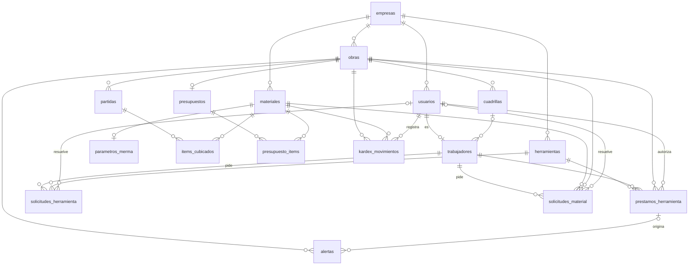

# Check-In-Obra

Sistema de cubicación, presupuesto e inventario para PYMEs de la construcción.
Proyecto capstone — DuocUC.

El problema que resuelve: en obras de tabiquería y cielos, el material se cubica
en planilla, se compra a ojo y el consumo real nunca se compara contra lo
presupuestado. Check-In-Obra cierra ese ciclo — cubica la partida, congela el
presupuesto, registra cada movimiento de bodega con QR y muestra la desviación
mientras la obra todavía está abierta.

---

## Índice

- [Stack](#stack)
- [Arquitectura](#arquitectura)
- [Estructura del repositorio](#estructura-del-repositorio)
- [Requisitos previos](#requisitos-previos)
- [Puesta en marcha](#puesta-en-marcha)
- [Comandos del día a día](#comandos-del-día-a-día)
- [API](#api)
- [Roles y permisos](#roles-y-permisos)
- [Base de datos](#base-de-datos)
- [App móvil](#app-móvil)
- [Documentación de diseño](#documentación-de-diseño)
- [Problemas frecuentes](#problemas-frecuentes)
- [Equipo](#equipo)

---

## Stack

### Backend
| Componente | Versión | Para qué |
|---|---|---|
| Java | 21 | Lenguaje |
| Spring Boot | 4.1.1 | Framework (Web MVC, Data JPA, Security, Validation, Mail) |
| PostgreSQL | 16 | Base de datos |
| Flyway | — | Migraciones versionadas del esquema |
| JJWT | 0.12.6 | Emisión y validación de JWT |
| springdoc-openapi | 2.8.6 | Swagger UI / OpenAPI 3 |
| Apache POI | 5.4.1 | Leer y generar las planillas `.xlsx` de la importación masiva |
| Lombok | — | Reduce boilerplate en entidades |
| Maven Wrapper | — | Build sin instalar Maven |

### Mobile
| Componente | Versión | Para qué |
|---|---|---|
| Flutter | 3.47.1 (stable) | Framework, solo Android |
| `mobile_scanner` | ^7.4.0 | Escáner de cámara: credencial QR del trabajador y código de barras de material y herramientas |
| `dio` | ^5.11.0 | Cliente HTTP contra la API |
| `flutter_riverpod` | ^2.6.1 | Manejo de estado |
| `drift` | ^2.34.3 | Base local (cola de movimientos sin conexión) |
| `flutter_secure_storage` | ^11.0.0 | Guardar el JWT y el PIN de forma segura |
| `file_picker` | ^12.2.0 | Elegir y guardar la planilla `.xlsx` de la importación masiva |
| `fl_chart` | ^1.2.0 | Gráficos de desviación y consumo |
| `intl` | ^0.20.3 | Formato de fechas y montos en es-CL |

---

## Arquitectura

Monorepo con dos aplicaciones que se comunican por HTTP/JSON:

```
┌────────────────────┐         REST + JWT          ┌────────────────────┐
│   App Flutter      │ ──────────────────────────► │  API Spring Boot   │
│   (Android)        │ ◄────────────────────────── │  :8080 en Docker   │
└────────────────────┘                             └─────────┬──────────┘
                                                             │ JDBC
                                                   ┌─────────▼──────────┐
                                                   │   PostgreSQL 16    │
                                                   └────────────────────┘
```

### Paquetes de dominio del backend

Uno por módulo del diagrama de clases. La regla es que `control` puede depender
de los demás, pero nadie depende de `control`:

| Paquete | Contiene |
|---|---|
| `config` | `Empresa`, `Usuario`, `RolUsuario`, seguridad JWT, manejo de errores |
| `obra` | `Obra`, `Cuadrilla`, `Trabajador`, `EstadoObra` |
| `cubicacion` | `Material`, `ParametroMerma`, `Partida`, `ItemCubicado`, `MotorCubicacion` |
| `presupuesto` | `Presupuesto`, `PresupuestoItem`, `ComparadorPresupuesto`, `ReporteDesviacion` |
| `inventario` | `KardexMovimiento`, `Herramienta`, `PrestamoHerramienta`, `SolicitudHerramienta`, `SolicitudMaterial` |
| `control` | `Alerta`, `TipoAlerta` |

**Números actuales:** 9 enums · 17 entidades JPA · 17 repositorios · 17 servicios ·
16 controladores REST · 51 rutas.

Cada capa tiene una responsabilidad clara:
- **Entidad** — estado y transiciones propias (`Obra.cerrar()`, `Presupuesto.congelar()`)
- **Servicio** — orquestación y reglas que cruzan agregados (validar que la obra
  no tenga herramientas fuera antes de cerrarla)
- **Controlador** — HTTP, validación de entrada y autorización por rol

### Reglas de negocio que vale la pena conocer

- **El stock no es una columna.** Es la suma con signo de los `KardexMovimiento`
  (`RECEPCION` suma, `DESPACHO`/`CONSUMO` restan). No existe stock negativo: un
  despacho mayor al disponible se rechaza con `409`.
- **Una solicitud no mueve nada por sí sola.** El trabajador crea la solicitud;
  recién cuando el bodeguero la aprueba se genera el `PrestamoHerramienta` o el
  `KardexMovimiento` de despacho.
- **Un presupuesto congelado no se toca.** `BORRADOR → APROBADO → CONGELADO`.
  Congelado, los precios dejan de seguir al catálogo: cambiar el precio de un
  material no altera presupuestos ya congelados.
- **Una obra no se cierra con cabos sueltos.** `Obra.cerrar()` exige cero
  herramientas sin devolver y cero alertas sin resolver.

---

## Estructura del repositorio

```
checkinobra/
├── backend/                         API REST en Spring Boot
│   ├── src/main/java/cl/duocuc/checkinobra/
│   │   ├── config/                  Empresa, Usuario, JWT, seguridad
│   │   ├── obra/                    Obra, Cuadrilla, Trabajador
│   │   ├── cubicacion/              Material, Partida, MotorCubicacion
│   │   ├── presupuesto/             Presupuesto, ComparadorPresupuesto
│   │   ├── inventario/              Kardex, Herramientas, Solicitudes
│   │   └── control/                 Alertas
│   ├── src/main/resources/
│   │   ├── application.properties
│   │   └── db/migration/            Migraciones Flyway (V1, V2)
│   ├── Dockerfile                   Build multi-etapa (Maven → JRE Alpine)
│   ├── .env.example
│   └── pom.xml
│
├── mobile/                          App Flutter (Android)
│   ├── lib/
│   │   ├── core/{theme,network}/    Tema visual y cliente HTTP
│   │   ├── data/{api,local_db}/     Repositorios remotos y base local
│   │   ├── features/                auth · cubicacion · presupuesto ·
│   │   │                            inventario · solicitudes · admin
│   │   └── shared_widgets/
│   ├── android/
│   ├── .env.example
│   └── pubspec.yaml
│
├── docs/
│   ├── diagrams/                    Diagrama de clases MVP1 (PNG)
│   ├── design-system/               Paleta, tipografía, reglas UX
│   └── mockups/                     3 lienzos de pantallas (.dc.html)
│
├── scripts/                         Utilidades del repo (emulador, skills)
├── docker-compose.yml
└── .env.example
```

---

## Requisitos previos

| Herramienta | Versión | Obligatorio para |
|---|---|---|
| Git | cualquiera reciente | Todo |
| Docker Desktop | 4.x | Backend + base de datos |
| JDK | **21** | Compilar el backend fuera de Docker |
| Flutter SDK | **3.47.1+** (stable) | App móvil |
| Android Studio | 2026.1+ | SDK de Android, emulador y editor |
| WSL 2 | — | **Solo Windows** — lo exige Docker Desktop |

El proyecto funciona igual en **Ubuntu** y **Windows**. Donde los comandos
difieren, este README muestra ambos. Los de `docker compose`, `git`, `flutter`
y `dart` son idénticos en los dos sistemas.

**No hace falta instalar:**
- **Maven** — el repo trae `mvnw` (Maven Wrapper), que se descarga solo.
- **PostgreSQL** — corre dentro de Docker. Instalarlo en el sistema solo genera
  conflictos de puerto.

### Instalación — Ubuntu

```bash
# JDK 21
sudo apt install openjdk-21-jdk

# Flutter
sudo snap install flutter --classic

# Android Studio: descargar de developer.android.com/studio
# (el asistente instala el SDK, platform-tools y un emulador)
```

Después de instalar Android Studio, agregar a `~/.bashrc`:

```bash
export ANDROID_HOME=$HOME/Android/Sdk
export ANDROID_SDK_ROOT=$ANDROID_HOME
export PATH=$PATH:$ANDROID_HOME/platform-tools:$ANDROID_HOME/cmdline-tools/latest/bin
```

Aplicar los cambios sin cerrar la terminal:

```bash
source ~/.bashrc
```

### Instalación — Windows

Docker Desktop en Windows necesita **WSL 2**. Si nunca lo instalaste, primero
(en PowerShell **como administrador**) y reiniciar:

```powershell
wsl --install
```

Después, todo lo demás con `winget` en una PowerShell normal:

```powershell
winget install EclipseAdoptium.Temurin.21.JDK
winget install Docker.DockerDesktop
winget install Google.AndroidStudio
winget install Git.Git
```

> Si `winget` no encuentra alguno, los identificadores cambian de vez en cuando.
> Las descargas oficiales siempre funcionan:
> [JDK 21](https://adoptium.net/temurin/releases/?version=21) ·
> [Docker Desktop](https://www.docker.com/products/docker-desktop/) ·
> [Android Studio](https://developer.android.com/studio)

**Flutter** conviene instalarlo manualmente para controlar la versión:

1. Descargar el ZIP estable desde [docs.flutter.dev/get-started/install/windows](https://docs.flutter.dev/get-started/install/windows)
2. Descomprimir en `C:\src\flutter` — **no** en `C:\Program Files`, porque esa
   ruta exige permisos elevados y rompe algunos comandos
3. Agregar `C:\src\flutter\bin` al `PATH`

Variables de entorno (PowerShell; `setx` las deja permanentes, así que hay que
**abrir una terminal nueva** para que tomen efecto):

```powershell
setx ANDROID_HOME "$env:LOCALAPPDATA\Android\Sdk"
setx ANDROID_SDK_ROOT "$env:LOCALAPPDATA\Android\Sdk"
setx PATH "$env:PATH;$env:LOCALAPPDATA\Android\Sdk\platform-tools;$env:LOCALAPPDATA\Android\Sdk\cmdline-tools\latest\bin;C:\src\flutter\bin"
```

También se pueden editar a mano en *Panel de control → Sistema → Configuración
avanzada → Variables de entorno*, que es menos propenso a errores si el `PATH`
ya está largo.

### Aceptar las licencias de Android

Igual en ambos sistemas, una sola vez por computador:

```bash
flutter doctor --android-licenses   # responder "y" a cada una
flutter doctor                      # Android toolchain debe quedar en [✓]
```

> `flutter doctor` marcará en rojo **Chrome** y —según el sistema— **Linux
> toolchain** o **Visual Studio**. Es esperado: el MVP1 es solo Android. No
> instales nada para resolver esos dos.

---

## Puesta en marcha

```bash
git clone https://github.com/4lan17/Capstone_Check-In-Obra.git
cd Capstone_Check-In-Obra
```

### 1. Backend + base de datos

Antes del primer arranque, crea el `.env` de la raíz con secretos propios: el de
los JWT y las contraseñas de la base (la API no arranca sin ellos;
`scripts/levantar.sh` los genera solos):

```bash
cp .env.example .env
# reemplaza cada CAMBIAR_...: openssl rand -base64 36 | tr -d '+/=\n'
```

```bash
docker compose up -d
```

> **Volumen de una versión anterior.** Los roles de la base (ver
> [Roles de la base](#roles-de-la-base)) los crea el entrypoint de Postgres, pero
> solo al inicializar un volumen nuevo. Con uno que ya existía, corre una vez
> `docker compose up -d --wait db && docker compose exec -T db /docker-entrypoint-initdb.d/01-roles.sh`
> antes de `docker compose up -d` (`scripts/levantar.sh` lo hace solo). Es
> idempotente y le pasa las tablas existentes al migrador, sin perder datos.

La primera vez tarda varios minutos: compila la imagen y descarga PostgreSQL.
Flyway crea el esquema completo y carga el usuario semilla automáticamente.

Verificar que respondió:

```bash
# Ubuntu
curl http://localhost:8081/v3/api-docs

# Windows (PowerShell)
curl.exe http://localhost:8081/v3/api-docs
```

> En PowerShell, `curl` es un alias de `Invoke-WebRequest` y **no** acepta los
> mismos parámetros. Por eso hay que escribir `curl.exe` con la extensión.
> En `cmd.exe` basta con `curl`.

Y abrir Swagger UI en **http://localhost:8081/swagger-ui.html**

### 2. Primer login

En una base vacía, al arrancar, la API crea la primera empresa (por defecto
Constructora Arauco Ltda., `PRIMERA_EMPRESA_RUT` y `PRIMERA_EMPRESA_NOMBRE`) y su
administrador, `admin@arauco-ltda.cl` (`PRIMER_ADMIN_EMAIL`). **No hay credencial
publicada**: la migración `V2` que sembraba el PIN `0000` salió de `db/migration`, y
en las bases que ya la habían aplicado la `V11` lo anuló. Su clave inicial es la de
`PRIMER_ADMIN_CLAVE` en el `.env` de la raíz (`scripts/levantar.sh` genera una; a
mano, define la tuya de 8 o más caracteres antes de arrancar). La API la aplica al
arrancar, solo si la cuenta aún no tiene credencial.

**Ubuntu**

```bash
curl -X POST http://localhost:8081/api/auth/login \
  -H 'Content-Type: application/json' \
  -d "{\"email\":\"admin@arauco-ltda.cl\",\"pin\":\"$PRIMER_ADMIN_CLAVE\"}"
```

**Windows (PowerShell)** — las comillas simples no sirven para el JSON, hay que
escapar las dobles:

```powershell
curl.exe -X POST http://localhost:8081/api/auth/login `
  -H "Content-Type: application/json" `
  -d "{\`"email\`":\`"admin@arauco-ltda.cl\`",\`"pin\`":\`"$env:PRIMER_ADMIN_CLAVE\`"}"
```

Devuelve un JWT y `debeCambiarClave: true`. **Con esa clave el administrador solo
puede cambiarla**: cualquier otra llamada responde `403` con
`codigo: DEBE_CAMBIAR_PIN`. Se cambia con `PUT /api/auth/pin`
(`{"pinActual": "...", "pinNuevo": "..."}`, 8 a 72 caracteres), que devuelve una
sesión nueva ya sin la obligación:

```bash
curl -X PUT http://localhost:8081/api/auth/pin \
  -H "Authorization: Bearer <token>" -H 'Content-Type: application/json' \
  -d '{"pinActual":"<la inicial>","pinNuevo":"<la tuya, 8 o más caracteres>"}'
```

El token se manda en las llamadas siguientes como `Authorization: Bearer <token>`.

> Por qué no hay un PIN fijo: con uno publicado, cualquiera que leyera este README
> podía entrar como administrador, cambiarlo y quedarse con la cuenta. La `V11`
> además marca a **todo usuario existente que no sea trabajador** para cambiar su
> clave en el próximo ingreso: el hash no revela el largo, y no se puede saber
> cuáles tienen todavía un PIN de 4 dígitos.

### Cuentas de prueba (los cuatro roles)

La base solo trae al administrador. Las demás cuentas las crea un script que usa
la API como admin:

```bash
python3 scripts/cuentas_de_prueba.py            # Windows: py scripts\cuentas_de_prueba.py
```

Se puede correr las veces que haga falta. Si la cuenta ya existe (la busca por
correo) no la duplica, solo le fija el PIN de la tabla. En una base vacía crea
además la obra **Los Almendros · Torre B** con una cuadrilla, y deja a los dos
trabajadores en ella: un trabajador sin cuadrilla no aparece en ninguna obra y el
bodeguero no puede despacharle nada.

| Rol | Correo | PIN | Qué ve hoy en la app |
|---|---|---|---|
| Administrador | `admin@arauco-ltda.cl` | `PRIMER_ADMIN_CLAVE` del `.env` (la cambia en su primer ingreso) | Obras, materiales, usuarios, empresa y la vista de bodega |
| Jefe de terreno | `rodrigo.carcamo@arauco-ltda.cl` | `jefe-1111-obra` | Pantalla de rol pendiente (su flujo no está construido) |
| Bodeguero | `jorge.reyes@arauco-ltda.cl` | `bodega-2222-obra` | Inicio, bodega, herramientas y alertas de la obra que elija |
| Trabajador | `marcelo.sepulveda@arauco-ltda.cl` | `3333` | Pantalla de rol pendiente (su flujo no está construido) |
| Trabajador | `javier.ortiz@arauco-ltda.cl` | `4444` | Idem |

Los correos y PINs salen de `CUENTAS` en el script: si cambias uno allá, cámbialo
acá. El jefe de terreno y el bodeguero usan una clave de 8 o más caracteres: la
API la exige a todo rol que no sea trabajador.

**Probar el escaneo de credencial sin la app del trabajador.** Como esa app
todavía no existe, no hay QR que mostrar. Corre el script con
`--renovar-credenciales`: imprime el código de cada trabajador (el anterior deja
de valer), y el bodeguero lo escribe en el ingreso manual del escáner.

> ⚠️ El script reemplaza PINs. Es solo para la base local: no lo corras contra un
> servidor real.

### 3. App móvil

```bash
cd mobile

cp .env.example .env                        # Ubuntu
copy .env.example .env                      # Windows (cmd)
Copy-Item .env.example .env                 # Windows (PowerShell)

flutter pub get
flutter run
```

Con el celular conectado por USB (con depuración USB activada) o el emulador
abierto. Confirmar que Flutter lo ve con `flutter devices`.

**Sobre el emulador** — si no tienes el celular a mano, el camino corto es:

```bash
scripts/run-emulador.sh
```

Arranca el AVD `Check-In-Obra_Pixel5` si no está corriendo, espera a que
termine de bootear, crea el `.env` desde `.env.example` si falta y lanza
`flutter run -d emulator-5554`. Lo que le pases se lo pasa a `flutter run`
(`scripts/run-emulador.sh --release`). Requiere tener el AVD creado — ver
[Emulador (teléfono virtual)](#emulador-teléfono-virtual).

> **En Windows, si el celular no aparece** en `flutter devices`, casi siempre
> falta el driver USB del fabricante. Instalar el
> [Google USB Driver](https://developer.android.com/studio/run/win-usb) desde
> Android Studio (SDK Manager → SDK Tools → *Google USB Driver*), o el driver
> propio de la marca del teléfono. En Ubuntu no hace falta driver.

#### Qué se ve al correrla

Por ahora la app abre en una **pantalla de verificación de conexión**. No es
una pantalla del producto: es una herramienta para el equipo que comprueba, de
una sola vez, que el teléfono llega hasta la base de datos.

Al tocar *Probar conexión* hace un login real contra `/api/auth/login` con el
usuario semilla y muestra:

- **En verde** — el rol, la empresa, el JWT recibido y la latencia. Eso
  significa que funcionan la red, la API, PostgreSQL y las migraciones.
- **En rojo** — la causa concreta y el comando para resolverla. Distingue entre
  firewall bloqueando, redes WiFi distintas, IP desactualizada en el `.env` y
  backend caído.

Es el punto de partida: las pantallas reales del MVP1 (acceso por rol,
cubicación, bodega, solicitudes) se construyen sobre esta base.

**Si la app dice "No se pudo alcanzar el servidor"**, revisa en este orden:

1. El backend está arriba — `docker compose ps`
2. El teléfono y el computador están en la **misma red WiFi**
3. La IP del `.env` es la actual — cambia cada vez que cambias de red

> Sobre el firewall: aunque UFW esté activo con política `DROP`, **normalmente
> no bloquea** los puertos publicados por Docker. Docker inserta sus propias
> reglas de iptables que se evalúan antes que las de UFW. Verificado en este
> proyecto: con UFW activo, el celular alcanzó `:8081` sin agregar ninguna regla.
> Si aun así no conecta, comprueba desde el propio teléfono antes de tocar el
> firewall:
>
> ```bash
> adb shell "curl -s -o /dev/null -w '%{http_code}' http://<IP-del-PC>:8081/v3/api-docs"
> ```
>
> Si eso devuelve `200`, el problema no es de red sino del `.env` de la app.

---

## Comandos del día a día

### Docker

```bash
docker compose up -d          # levantar en segundo plano
docker compose up             # levantar viendo los logs (Ctrl+C baja todo)
docker compose logs -f        # seguir los logs
docker compose logs backend   # solo el backend
docker compose ps             # estado de los servicios
docker compose down           # bajar, CONSERVANDO los datos
docker compose down -v        # bajar y BORRAR la base (empezar de cero)
docker compose build          # reconstruir la imagen tras cambiar código
```

Estos comandos son **idénticos en Ubuntu y Windows**.

> `docker compose` solo actúa sobre este proyecto. El `name: checkinobra` del
> compose etiqueta contenedores, red y volumen, así que nunca toca otros stacks
> que tengas corriendo.

### Backend sin Docker (desde el IDE)

Necesitas la base levantada (`docker compose up -d db`) y un `.env` con el
datasource apuntando a `localhost:5433`.

El Maven Wrapper cambia de nombre según el sistema:

**Ubuntu**

```bash
cd backend
./mvnw compile                  # compilar
./mvnw package -DskipTests      # generar el .jar
./mvnw spring-boot:run          # ejecutar
./mvnw test                     # pruebas
```

**Windows**

```powershell
cd backend
.\mvnw.cmd compile
.\mvnw.cmd package -DskipTests
.\mvnw.cmd spring-boot:run
.\mvnw.cmd test
```

> Ambos archivos ya vienen en el repo y `.gitattributes` fija sus finales de
> línea (`mvnw` en LF, `mvnw.cmd` en CRLF), así que funcionan sin importar la
> configuración de Git de cada quien.

### Mobile

```bash
cd mobile
flutter pub get                       # instalar dependencias
flutter analyze                       # análisis estático
flutter run                           # correr en el dispositivo
flutter run -d emulator-5554          # correr en el emulador (ver scripts/run-emulador.sh)
flutter build apk --debug             # APK de depuración
flutter build apk --release           # APK de release
dart run build_runner build           # generar código de Drift
flutter devices                       # ver dispositivos conectados
```

Estos comandos son **idénticos en Ubuntu y Windows**.

---

## API

Base: `http://localhost:8081` · Swagger: `/swagger-ui.html`

| Recurso | Ruta base |
|---|---|
| Autenticación | `/api/auth` |
| Empresas | `/api/empresas` |
| Usuarios | `/api/usuarios` |
| Obras | `/api/obras` |
| Cuadrillas | `/api/cuadrillas` |
| Trabajadores | `/api/trabajadores` |
| Materiales | `/api/materiales` |
| Parámetros de merma | `/api/materiales/{id}/merma` |
| Partidas y cubicación | `/api/partidas` |
| Presupuestos | `/api/presupuestos` |
| Kardex | `/api/kardex` |
| Herramientas | `/api/herramientas` |
| Préstamos | `/api/prestamos-herramienta` |
| Solicitudes de herramienta | `/api/solicitudes-herramienta` |
| Solicitudes de material | `/api/solicitudes-material` |
| Alertas | `/api/alertas` |

### Dar de alta una constructora

No hay endpoint para crearla, y no es un olvido. Lo hubo, y era incoherente: el
ADMIN que creaba una empresa no podía verla después, porque el aislamiento por
empresa lo dejaba fuera de la que acababa de crear. Dar de alta un tenant no es
una operación de un tenant — necesitaría un rol por encima de los cuatro, y
este sistema tiene cuatro por diseño.

Una constructora nueva se crea por migración junto con su primer ADMIN, como
hacía `V2__seed_admin.sql`:

```sql
INSERT INTO empresas (nombre, rut) VALUES ('Constructora Nueva Ltda.', '77.111.222-3');

INSERT INTO usuarios (nombre, email, rol, pin_hash, debe_cambiar_pin, empresa_id)
VALUES ('Admin Nueva', 'admin@nueva.cl', 'ADMIN',
        '<hash BCrypt de una clave temporal de 8 o más caracteres, que no esté en el repo>',
        TRUE,
        (SELECT id FROM empresas WHERE rut = '77.111.222-3'));
```

Con `debe_cambiar_pin = TRUE` su primera acción tiene que ser cambiar esa clave.

### Escaneo e importación masiva

Los endpoints que sostienen el escáner del bodeguero y la carga de catálogo:

| Método y ruta | Para qué | Rol |
|---|---|---|
| `GET /api/trabajadores/por-credencial/{qr}` | Resolver la credencial QR que el bodeguero acaba de escanear | Bodeguero · Jefe · Admin |
| `GET /api/materiales/por-codigo/{codigo}` | Resolver un código de barras **o** un SKU al material del catálogo | Autenticado |
| `GET /api/herramientas/por-codigo/{codigo}` | Ídem para el código impreso en la etiqueta de una herramienta | Autenticado |
| `POST /api/materiales/importar` | Alta masiva de materiales desde `.xlsx` | Admin |
| `POST /api/herramientas/importar` | Alta masiva de herramientas desde `.xlsx` | Bodeguero · Admin |
| `GET /api/materiales/plantilla-importacion` | Descargar la planilla vacía con las columnas en orden | Admin |
| `GET /api/herramientas/plantilla-importacion` | Ídem para herramientas | Bodeguero · Admin |

Los dos `importar` son `multipart/form-data` con el archivo en el campo
`archivo`, y aceptan `?confirmar=`:

- **`confirmar=false`** (por defecto) — **simula**. Valida el archivo completo y
  devuelve el mismo informe que devolvería la importación real, sin escribir
  nada. Es lo que la app muestra antes de dejar apretar el botón.
- **`confirmar=true`** — importa, y solo si **ninguna** fila tiene problemas.

La importación es **todo o nada**. Con una fila mala no se guarda ninguna: se
corrige la planilla y se vuelve a subir. Importar "lo que se pueda" deja el
catálogo a medias y sin forma de saber qué entró. El informe es el mismo en los
dos casos:

```json
{
  "confirmado": false,
  "filasLeidas": 34,
  "filasValidas": 33,
  "importadas": 0,
  "errores": [
    { "fila": 12, "detalle": "La categoría 'PLANCHA' no existe (válidas: METALCOM, VOLCANITA, OSB, FIJACION)" }
  ]
}
```

El número de fila es **el que muestra Excel**, para poder ir directo a
corregirla. El tope es de 2.000 filas y 5 MB por archivo: una planilla de
catálogo pesa kilobytes, y un archivo mucho mayor casi siempre es el archivo
equivocado.

### Autenticación

Dos formas de entrar, ambas devuelven el mismo JWT:

- `POST /api/auth/login` — correo + clave. Admin, jefe de terreno y bodeguero
  usan una **clave de 8 a 72 caracteres**; el trabajador, su PIN de 4 dígitos. El
  campo del cuerpo es `pin` (también se acepta `clave`).
- `POST /api/auth/login-pin` — id de usuario + PIN. **Solo para el trabajador**,
  cuyo teléfono ya lo tiene identificado (nadie escribe un correo con guantes
  puestos). Con el id de otro rol responde igual que con un PIN equivocado.

**Intentos fallidos.** Tras 5 fallos seguidos la cuenta se bloquea 1 minuto; desde
ahí, cada fallo más la bloquea otra vez con el doble de tiempo (hasta 1 hora). Una
IP con 30 fallos se bloquea 5 minutos, también creciente. Mientras dura el bloqueo
la API responde `429` con la cabecera `Retry-After` (segundos) y
`codigo: DEMASIADOS_INTENTOS`, **sin mirar la clave**: ni la correcta entra. Un
acierto reinicia la cuenta. Las cuentas que no existen se bloquean igual y tardan
lo mismo que las que sí, para no revelar qué correos están registrados. Los
topes se ajustan con `checkinobra.login.*` (ver `application.properties`). El
estado vive en memoria, así que se reinicia con la API y no se comparte entre
instancias; y la IP es la del socket (`getRemoteAddr`), que tras un proxy será la
del proxy hasta configurar `server.forward-headers-strategy`.

### Sesión y tokens

- **El token de acceso dura 30 minutos** (`checkinobra.jwt.expiracion-minutos`; antes, 8 horas) y lleva el id, el rol y la empresa del usuario, el emisor (`iss=checkinobra`), la audiencia (`aud=checkinobra-api`) y la versión de sesión (`tv`). Un token sin esos campos, o con otros, no entra.
- **Se revalida en cada petición**: el usuario tiene que existir y seguir con la misma `token_version` con que se emitió el token. La versión sube al **restablecer la clave** de un usuario o al **cambiar la propia**, y deja sin efecto, de inmediato, todos sus tokens anteriores (y sus refresh tokens).
- **Refresh token**: cada login (y cada cambio de clave) devuelve también `refreshToken`. `POST /api/auth/refresh` con `{"refreshToken": "..."}` devuelve un par nuevo (acceso y refresh) y deja revocado el presentado (rotación). Dura 7 días sin usarse (`checkinobra.jwt.refresh-dias`). Se guarda solo su hash. **Si se presenta uno ya usado se asume robo y se revocan todas las sesiones del usuario.** Un refresh que no sirve (inexistente, vencido, revocado, mal formado) responde siempre `401` con `codigo: SESION_INVALIDA`, sin decir cuál fue el motivo.
- `POST /api/auth/logout` con el mismo cuerpo revoca el refresh token y responde siempre `204`.

### Registro de eventos de seguridad

El logger `seguridad` escribe una línea `evento=… clave=valor` por login exitoso, fallido y bloqueado, acceso denegado (403 por rol), clave restablecida o cambiada, usuario creado y uso o reutilización de un refresh token. Lleva el id de usuario y de empresa y la IP; **nunca** claves, tokens ni correos. Se puede enviar aparte configurando ese logger en `logback`.

### Errores

El cuerpo de un error lleva el mensaje solo de las excepciones que escribimos nosotros; las de librerías (`Invalid UUID string: …`, `No value present`) salen con un texto genérico y el original queda en el log.

### Códigos de respuesta

| Código | Cuándo |
|---|---|
| `400` | Datos inválidos o credenciales incorrectas |
| `403` | Sin token, o el rol no autoriza esa acción |
| `404` | El recurso no existe |
| `409` | La operación choca con una regla de negocio (stock insuficiente, presupuesto ya congelado, obra con herramientas fuera) |

---

## Roles y permisos

Una sola clase `Usuario` para los cuatro roles. Lo que cambia entre uno y otro
es `Usuario.rol`, y con eso el backend decide qué autoriza (`@PreAuthorize`).

| Acción | Trabajador | Bodeguero | Jefe terreno | Admin |
|---|:---:|:---:|:---:|:---:|
| Solicitar herramienta o material | ✅ | — | — | — |
| Mostrar credencial QR | ✅ | — | — | — |
| Escanear la credencial de un trabajador | — | ✅ | ✅ | ✅ |
| Aprobar o rechazar solicitudes | — | ✅ | — | ✅ |
| Recepción, despacho y consumo | — | ✅ | — | ✅ |
| Autorizar préstamo y devolución | — | ✅ | — | ✅ |
| Cerrar turno de bodega | — | ✅ | — | ✅ |
| Cubicar partidas | — | — | ✅ | ✅ |
| Congelar presupuesto | — | — | ✅ | ✅ |
| Resolver alertas | — | ✅ | ✅ | ✅ |
| Crear usuarios y asignar rol | — | — | — | ✅ |
| Catálogo, precios y mermas | — | — | — | ✅ |
| Importar materiales desde Excel | — | — | — | ✅ |
| Importar herramientas desde Excel | — | ✅ | — | ✅ |
| Crear y cerrar obras | — | — | — | ✅ |
| Consultar kardex y stock de una obra | — | ✅ | ✅ | ✅ |
| Consultar el padrón de usuarios | — | — | — | ✅ |
| Asignar el jefe de terreno de una obra | — | — | — | ✅ |

Las dos últimas filas son lecturas, y también van restringidas: un endpoint sin
`@PreAuthorize` queda abierto a los cuatro roles, que casi nunca es lo buscado.

### Dónde vive el RUT

En `Usuario`, no en `Trabajador`. Estaba en `Trabajador` y ahí no alcanzaba: un
jefe de terreno o un bodeguero no tienen registro de trabajador —
`TrabajadorService` rechaza cualquier rol que no sea `TRABAJADOR`— así que no
había dónde guardar el suyo. El RUT identifica a una **persona**, no a un rol.

La migración `V3` lo sube a `usuarios`, lo rellena desde `trabajadores` y borra
la columna duplicada. `Trabajador.rut()` lo lee de su `Usuario`. Queda nulo solo
para los usuarios anteriores a esa migración; la API lo exige al crear.

La misma migración agrega `obras.jefe_terreno_id` (el mockup `AdminObras` ya
tenía esa columna y el modelo nunca la tuvo) y `kardex_movimientos.trabajador_id`
(quién **recibe**, que no es quién **registra**).

### Aislamiento entre empresas

El rol decide **qué** puede hacer alguien. La empresa decide **sobre qué datos**.
Son dos preguntas distintas y hacen falta las dos: un bodeguero con un token
perfectamente válido no tiene por qué ver el inventario de otra constructora.

- La empresa **siempre sale del token**, nunca de la petición. Ningún endpoint
  recibe ya un `empresaId` por query param ni en el cuerpo: pedir los datos de
  otra constructora dejó de ser expresable.
- Toda entidad implementa `PerteneceAEmpresa` y sabe decir de quién es
  recorriendo su propia cadena (`Cuadrilla → Obra → Empresa`).
- Un recurso de otra empresa devuelve **el mismo 404, con el mismo mensaje**,
  que un id que no existe. Distinguirlos —403 para lo ajeno, 404 para lo
  inexistente— permitiría recorrer los ids del sistema y contar las obras de la
  competencia.

Los tests que lo sostienen viven en `backend/src/test/.../config/`:
`AislamientoEntreEmpresasTest` falla si alguien agrega una entidad sin
`PerteneceAEmpresa` o un endpoint que reciba `empresaId` desde afuera, y
`RespuestasNoExponenEntidadesTest` falla si un controlador vuelve a devolver una
entidad JPA.

### Forma de las respuestas

Ningún controlador devuelve entidades: cada uno tiene su `record` de respuesta
(`ObraResponse`, `KardexMovimientoResponse`, …) con las relaciones aplanadas a
su id más la etiqueta mínima para leerlas. Devolver la entidad arrastraba el
grafo entero por los `@ManyToOne(fetch = EAGER)` —y con él, en su momento, el
hash BCrypt del PIN de cada usuario—. `Usuario.pinHash` conserva además
`@JsonIgnore` como red de seguridad.

Dos records de trabajador, a propósito: `TrabajadorResponse` sin la credencial
QR, y `TrabajadorCredencialResponse` solo al emitirla o renovarla. Ese QR es un
UUID portador — quien lo tiene se presenta en bodega como ese trabajador.

---

## Base de datos

### Puertos

| Servicio | Host | Dentro de Docker |
|---|---|---|
| Backend (API + Swagger) | `8081` | `8080` |
| PostgreSQL | `5433` | `5432` |

Se usan 8081 y 5433 en el host —no los 8080/5432 habituales— porque esos puertos
suelen estar ocupados por otros proyectos. Entre contenedores la comunicación
sigue siendo `db:5432`, así que la aplicación no se entera del cambio.

El puerto de PostgreSQL se publica **solo en `127.0.0.1`**: desde otra máquina de
la red no se llega a la base (antes se publicaba en todas las interfaces).

### Roles de la base

Ninguno de los tres usuarios que toca el sistema es de uso libre:

| Rol | Para qué | Permisos | Contraseña (en `.env`) |
|---|---|---|---|
| `checkinobra_app` | La API en ejecución | Solo `SELECT`, `INSERT`, `UPDATE` y `DELETE`. No es superusuario y no puede crear, alterar ni borrar tablas | `DB_APP_PASSWORD` |
| `checkinobra_migrador` | Flyway, al arrancar | Dueño del esquema: aplica las migraciones (DDL). Tampoco es superusuario | `DB_MIGRADOR_PASSWORD` |
| `checkinobra_plataforma` | La API, para leer y escribir la **base de catálogo** | Solo `SELECT/INSERT/UPDATE/DELETE` en `checkinobra_catalogo`. No puede conectarse a la base de una empresa | `DB_PLATAFORMA_PASSWORD` |
| `postgres` | Administración | Superusuario. La API no lo usa | `POSTGRES_PASSWORD` |

Los crea `db/crear-roles.sh` (SQL en `db/roles.sql`). `ALTER DEFAULT PRIVILEGES` hace
que las tablas que cree una migración nueva queden accesibles para la API sin
escribir un `GRANT` en cada una. Para comprobarlo:
`SELECT rolsuper FROM pg_roles WHERE rolname = 'checkinobra_app'` devuelve `f`.

Si un fallo de la API la compromete, quien la controla puede leer y escribir datos,
pero no borrar tablas ni cambiar el esquema. Cada rol solo puede conectarse a su
base: `checkinobra_app` a la de la empresa, `checkinobra_plataforma` al catálogo.

### Seguridad de la cadena de entrega

- **CI** (`.github/workflows`): permisos mínimos (`contents: read`), todas las acciones fijadas por SHA, `CodeQL` sobre el backend y revisión de dependencias en cada PR (`dependency-review`, bloquea severidad alta). **Estos dos jobs solo corren si la variable de repositorio `GHAS` vale `true`** (Settings → Secrets and variables → Actions → Variables): exigen GitHub Advanced Security y en un repositorio privado sin ella fallarían en cada PR. Quien lo habilite define la variable y, para `dependency-review`, activa también el grafo de dependencias.
- **Dependabot** (`.github/dependabot.yml`): maven, pub, github-actions, docker y docker-compose, una vez por semana.
- **Imágenes** (`backend/Dockerfile`, `docker-compose.yml` y la CI): fijadas por digest; el contenedor del backend no corre como root y tiene `HEALTHCHECK`. Dependabot propone el digest nuevo.
- springdoc está en la línea 3.x, la de Spring Boot 4.

### Operadores de plataforma (rol `PLATAFORMA`)

El personal de la plataforma entra por `POST /api/plataforma/auth/login` (`{"email","clave"}`) y no pertenece a ninguna empresa: vive en la tabla `operadores` del catálogo, y su token lleva `rol=PLATAFORMA` y **no lleva `empresaId`**. Se revalida en cada petición contra el catálogo (el operador debe estar activo y con la `token_version` del token). Tiene las mismas defensas de login que una empresa (bloqueo por cuenta e IP, mismo error para clave equivocada, correo inexistente y operador desactivado) y una clave de **12 a 72 caracteres**.

- `/api/plataforma/**` exige `PLATAFORMA`: un token de empresa recibe **403**.
- Toda ruta de empresa (también las que solo piden "estar autenticado", como `PUT /api/auth/pin`) rechaza un token de plataforma con **403**.
- Un token de empresa sin `empresaId` es **401** (no 500), y uno de plataforma que además trae `empresaId` también.
- `PLATAFORMA` no se puede asignar a un usuario de empresa (`UsuarioService.crear` lo rechaza).
- Rutas por ahora: `GET /api/plataforma/yo` y `GET /api/plataforma/empresas` (sin usuario de base ni referencia al secreto).
- **Alta de una constructora**: `POST /api/plataforma/empresas` con `{"rut","nombre","adminEmail","adminClave"?,"copiarCatalogoBase"?}` crea, en una sola operación y sin reiniciar la API: el registro en el catálogo, la base `checkinobra_e<dígitos del RUT>` y su usuario de PostgreSQL (`app_e<dígitos>`, solo DML y solo conectado a su base), el esquema (Flyway), la empresa con el mismo id que tiene en el catálogo, el pool en caliente y el primer **ADMIN**, obligado a cambiar la clave en su primer ingreso. Si no se envía `adminClave`, se genera una y se devuelve **una sola vez** en `claveTemporal`. Con `copiarCatalogoBase: true` copia ~12 materiales de referencia (placa yeso-cartón, perfiles, tornillos, OSB; `db/catalogo-base/materiales.csv`) con precios de referencia que la empresa edita. El RUT es único y se valida (400 si no es válido, 409 si ya existe). **Si un paso falla se deshace todo**: la empresa del catálogo, la base, el usuario de PostgreSQL, el secreto y el correo reservado.
  - Requiere el rol `checkinobra_aprovisionador` (`CREATEDB` y `CREATEROLE`; `DB_APROVISIONADOR_PASSWORD`), distinto del de la API y del migrador. Sin esa variable el alta responde que no está habilitada. Es una credencial poderosa: guardarla solo donde corre la API. Puede hacer `SET ROLE` al migrador (PostgreSQL lo exige para crear una base cuyo dueño es el migrador) pero no hereda sus permisos.
  - **La contraseña de cada base nueva no está en el catálogo ni en el entorno**: el catálogo guarda la referencia `file:app_e<dígitos>` y el secreto es un archivo (modo `600`) del directorio `SECRETOS_DIR` (`/secretos` en el contenedor, un volumen `secretos`). **Ese volumen hay que respaldarlo junto con las bases**: si se pierde, las bases de esas empresas no se pueden abrir.
- **Suspender y reactivar**: `PUT /api/plataforma/empresas/{id}/estado` con `{"estado":"SUSPENDIDA"}` (o `"ACTIVA"`). Idempotente. Una empresa suspendida pierde su pool y **recibe `403` con `codigo: EMPRESA_SUSPENDIDA` en cada petición** (la decide `JwtAuthFilter` a partir del catálogo, sin abrir su base); su gente no puede volver a entrar (el login responde como para una cuenta inexistente) y las tareas programadas la saltan. **No toca sus datos**, y las demás empresas siguen igual. Reactivarla la devuelve a como estaba, con los mismos tokens aún vigentes.
- **Respaldo y restauración por base** (`pg_dump`, por empresa: el archivo de una constructora no trae datos de otra). La imagen del backend **no incluye `pg_dump`** (`eclipse-temurin:21-jre-alpine` no lo trae): el respaldo es un trabajo aparte, con las herramientas de PostgreSQL del contenedor de la base o del servidor:
  ```bash
  # nombre de la base: columna empresas.nombre_base del catálogo (p. ej. checkinobra_e764123309)
  export CHECKINOBRA_MIGRADOR_PASSWORD=...        # DB_MIGRADOR_PASSWORD del .env
  export PG_PREFIX="docker compose exec -T db"    # sin esto usa pg_dump del PATH (PGHOST/PGPORT)
  scripts/respaldar-empresa.sh checkinobra_e764123309 ./respaldos   # imprime el archivo (-Fc, modo 600, verificado)

  export CHECKINOBRA_APROVISIONADOR_PASSWORD=...
  scripts/restaurar-empresa.sh respaldos/<archivo>.dump checkinobra_e764123309 app_e764123309
  ```
  **`pg_dump` y `pg_restore` deben ser de la misma versión mayor que el servidor.** Uno más nuevo escribe un volcado con parámetros que un servidor más viejo no conoce (un `pg_dump` 17 sobre PostgreSQL 16 trae `SET transaction_timeout`, que el 16 rechaza) y la restauración falla a mitad; uno más viejo se niega a volcar. Los dos scripts lo comprueban antes de tocar nada y se detienen con el código 4 si difieren. Por eso se recomienda `PG_PREFIX` con las herramientas del propio contenedor de la base, que siempre coinciden con su servidor (es lo que hace la CI).
  `restaurar-empresa.sh` **nunca sobrescribe** (si la base ya existe, se detiene), crea la base con los permisos de una empresa dada de alta, carga el respaldo y, si algo falla, **borra la base a medias**. Para recuperar una empresa cuya base se perdió, se restaura con el mismo nombre de base y usuario del catálogo y después se reactiva (`PUT …/estado` con `"ACTIVA"`) para que la API abra su pool. Los respaldos tienen los datos de la empresa: guardarlos cifrados y fuera del servidor. Programarlos (cron) es de quien despliega; el repositorio no lo hace. Estos scripts respaldan **las bases**, no el volumen `secretos`, que hay que respaldar aparte.
- **Borrar una empresa** (no hay endpoint a propósito: es irreversible y lo hace una persona, con respaldo): (1) suspenderla; (2) respaldarla y guardar el archivo fuera del servidor; (3) en la base de catálogo, `DELETE FROM indice_login WHERE empresa_id = <id>; DELETE FROM empresas WHERE id = <id>;`; (4) reactivar el refresco de pools reiniciando la API o con cualquier `PUT …/estado` de otra empresa; (5) `DROP DATABASE checkinobra_e…;` y `DROP ROLE app_e…;` (con el rol aprovisionador o el superusuario, sin conexiones abiertas); (6) borrar el archivo `app_e…` del directorio de secretos. Sin el paso 2 no hay vuelta atrás.
- **Primer operador**: si el catálogo no tiene ninguno y se definen `PLATAFORMA_OPERADOR_EMAIL` y `PLATAFORMA_OPERADOR_CLAVE`, se crea al arrancar. Con operadores ya creados las variables se ignoran.

### Base de catálogo

`checkinobra_catalogo` guarda qué empresas existen y cómo conectarse a la base de
cada una (tablas `planes`, `empresas`, `operadores` e `indice_login`, esta última
de correo a empresa). Sus migraciones están en `backend/src/main/resources/db/catalogo`
y las aplica el migrador al arrancar la API. El catálogo guarda una
*referencia* al secreto (`env:SPRING_DATASOURCE_PASSWORD`), nunca la contraseña.
Las decisiones de diseño están en
[`docs/arquitectura/multitenant.html`](docs/arquitectura/multitenant.html).

### Una base por empresa: el enrutador

Cada petición abre **solo la base de la empresa de su token** (MT2):

1. `JwtAuthFilter` valida el token y deja su `empresaId` en el `TenantContext` (un `ThreadLocal`), que limpia en un `finally` cuando termina toda la cadena. Un token sin `empresaId`, o de una empresa sin base registrada o suspendida, no abre nada y la petición sale como `401`.
2. `TenantRoutingDataSource` (un `AbstractRoutingDataSource`) entrega la conexión del pool de esa empresa. **No tiene base por defecto**: sin empresa en el contexto, tocar la base lanza `SinEmpresaEnContextoException` (un `500`, no un conflicto).
3. Hay un pool por empresa, armado al arrancar leyendo el catálogo (`ResolutorPorCatalogo`) con la contraseña que indica la referencia `env:VARIABLE`. Una empresa mal registrada se anota en el log y no impide arrancar a las demás.
4. En el arranque, `BaseInicialInicializador` registra en el catálogo la base actual con el id de su empresa y, en una base vacía con `PRIMER_ADMIN_CLAVE`, crea la empresa. Fuera de una petición (arranque, tareas programadas) la empresa se fija a mano con `TenantContext.ejecutarEn`.

**El login resuelve la empresa antes de tocar la base.** `POST /api/auth/login` busca el correo en el índice del catálogo; `POST /api/auth/login-pin` recibe `empresaId` junto a `usuarioId` (los ids de usuario se repiten entre bases; si falta y hay una sola empresa se usa esa). Un correo o empresa desconocidos se tratan como una cuenta que no existe, y un usuario encontrado en la base pedida solo vale si es de esa empresa (segunda comprobación, además de abrir su base). Crear un usuario reserva su correo en el catálogo, donde es único en todo el sistema.

**Hibernate ya no valida el esquema al arrancar**: no hay una base a la cual conectarse sin empresa. El dialecto se fija a mano y `ddl-auto=none`; la suite de pruebas sí valida el mapeo contra una base.

### Flyway por base

Las migraciones de `db/migration` las corre `MigradorDeBases` (Flyway programático; el de Spring Boot está desactivado porque migra una sola base) **sobre la base de cada empresa del catálogo**, con el usuario migrador y una por una:

- Al arrancar recorre las empresas activas. Una base **vacía** registrada en el catálogo queda con el esquema completo y en la última versión en ese mismo paso; una ya migrada no cambia.
- El resultado de cada base queda en el catálogo (`empresas.migracion_estado`: `PENDIENTE`, `OK` o `ERROR`, con `migracion_error` y `migrada_en`).
- **Una base que falla queda anotada, sin abrir (su empresa no tiene pool y sus tokens no valen) y no impide arrancar a las demás.** Una base nueva empieza `PENDIENTE` y solo se abre cuando su migración sale `OK`.
- `RegistroIdempotencia.purgarVencidas`, la única tarea programada, recorre las empresas con base abierta y fija la de cada una (MT2).

La base de una empresa tiene que existir antes y el migrador, poder conectarse y crear tablas en ella; crearla es parte del alta de empresas (fase 4). `db/crear-base-de-empresa.sql` hace ese paso de infraestructura (la base vacía, con el migrador de dueño y la API con permiso de conexión y de DML) y es lo que usan las pruebas de aislamiento para tener una segunda base.


### Conectarse con un cliente SQL

| Campo | Valor |
|---|---|
| Host | `localhost` (solo desde esta máquina) |
| Puerto | `5433` |
| Base | `checkinobra` |
| Usuario | `checkinobra_app` para consultar; `checkinobra_migrador` para cambiar el esquema a mano |
| Contraseña | `DB_APP_PASSWORD` o `DB_MIGRADOR_PASSWORD` del `.env` de la raíz |

O por terminal, como superusuario (por el socket del contenedor, sin contraseña):

```bash
docker compose exec db psql -U postgres -d checkinobra
```

### Migraciones

El esquema lo maneja **Flyway**, no Hibernate (`ddl-auto=validate`: Hibernate
solo verifica que las entidades calcen con las tablas).

| Archivo | Qué hace |
|---|---|
| `V1__init_schema.sql` | Crea las 17 tablas con sus llaves foráneas e índices |
| `V2__seed_admin.sql` | **Ya no está** (MT1): sembraba la empresa y el admin con el PIN `0000`. Las bases que la aplicaron la conservan en su historial; la `V11` anuló su PIN |
| `V3__rut_en_usuario_...sql` | Sube el RUT a `usuarios`, agrega el jefe de la obra y el receptor del despacho |
| `V4__codigo_de_barra_en_materiales.sql` | Agrega `materiales.codigo_barra` (único **por empresa**) para el escáner |
| `V5__normaliza_codigos_a_mayusculas.sql` | Pasa a mayúsculas los SKU y códigos de herramienta existentes |

**Para cambiar el esquema** se crea un archivo nuevo (`V3__...sql`). Nunca se
edita una migración ya aplicada: Flyway guarda un hash de cada una y falla si
detecta que cambió.

### Esquema

17 tablas, agrupadas por los mismos módulos del diagrama de clases. El mapa de
relaciones (las llaves foráneas, sin columnas para que se lea):



Todo `id` es `BIGSERIAL PRIMARY KEY` y se omite de las tablas de abajo. Los
enums no son tipos de PostgreSQL: se guardan como `VARCHAR` con el nombre de la
constante Java (`@Enumerated(EnumType.STRING)`), y los valores válidos están más
abajo.

#### Configuración

**`empresas`**

| Columna | Tipo | Notas |
|---|---|---|
| `nombre` | `VARCHAR(200)` | NOT NULL |
| `rut` | `VARCHAR(20)` | NOT NULL, UNIQUE |

**`usuarios`**

| Columna | Tipo | Notas |
|---|---|---|
| `nombre` | `VARCHAR(200)` | NOT NULL |
| `email` | `VARCHAR(200)` | NOT NULL, UNIQUE |
| `rol` | `VARCHAR(20)` | NOT NULL — enum `RolUsuario` |
| `pin_hash` | `VARCHAR(100)` | nullable — BCrypt, nunca el PIN en claro |
| `empresa_id` | `BIGINT` | NOT NULL → `empresas` |

#### Obra y equipos

**`obras`**

| Columna | Tipo | Notas |
|---|---|---|
| `nombre` | `VARCHAR(200)` | NOT NULL |
| `cliente` | `VARCHAR(200)` | NOT NULL |
| `ubicacion` | `VARCHAR(300)` | NOT NULL |
| `estado` | `VARCHAR(20)` | NOT NULL — enum `EstadoObra` |
| `empresa_id` | `BIGINT` | NOT NULL → `empresas` |

**`cuadrillas`**

| Columna | Tipo | Notas |
|---|---|---|
| `nombre` | `VARCHAR(200)` | NOT NULL |
| `obra_id` | `BIGINT` | NOT NULL → `obras` |

**`trabajadores`**

| Columna | Tipo | Notas |
|---|---|---|
| `rut` | `VARCHAR(20)` | NOT NULL, UNIQUE |
| `credencial_qr` | `VARCHAR(100)` | UNIQUE, nullable |
| `usuario_id` | `BIGINT` | NOT NULL, UNIQUE → `usuarios` |
| `cuadrilla_id` | `BIGINT` | nullable → `cuadrillas` |

El `UNIQUE` en `usuario_id` es lo que hace que la relación sea 1–1: un
`Trabajador` extiende a un `Usuario`, no es una entidad aparte.

#### Cubicación

**`materiales`**

| Columna | Tipo | Notas |
|---|---|---|
| `sku` | `VARCHAR(50)` | NOT NULL, único por empresa (`UNIQUE (empresa_id, sku)`, V13) — interno, el de la guía de despacho |
| `codigo_barra` | `VARCHAR(50)` | UNIQUE **por empresa**, nullable — el de fábrica, lo que lee el escáner |
| `nombre` | `VARCHAR(200)` | NOT NULL |
| `categoria` | `VARCHAR(20)` | NOT NULL — enum `CategoriaMaterial` |
| `precio_unitario` | `DOUBLE PRECISION` | NOT NULL |
| `stock_minimo` | `DOUBLE PRECISION` | NOT NULL — bajo esto se dispara `STOCK_CRITICO` |
| `empresa_id` | `BIGINT` | NOT NULL → `empresas` |

**`parametros_merma`**

| Columna | Tipo | Notas |
|---|---|---|
| `porcentaje` | `DOUBLE PRECISION` | NOT NULL |
| `material_id` | `BIGINT` | NOT NULL, UNIQUE → `materiales` |

**`partidas`**

| Columna | Tipo | Notas |
|---|---|---|
| `tipo` | `VARCHAR(20)` | NOT NULL — enum `TipoPartida` |
| `ancho_m` | `DOUBLE PRECISION` | NOT NULL |
| `alto_m` | `DOUBLE PRECISION` | NOT NULL |
| `separacion_montantes` | `DOUBLE PRECISION` | NOT NULL |
| `obra_id` | `BIGINT` | NOT NULL → `obras` |

**`items_cubicados`**

| Columna | Tipo | Notas |
|---|---|---|
| `cantidad_calculada` | `DOUBLE PRECISION` | NOT NULL — salida del motor de cubicación |
| `cantidad_con_merma` | `DOUBLE PRECISION` | NOT NULL — la anterior más el % de merma |
| `partida_id` | `BIGINT` | NOT NULL → `partidas` |
| `material_id` | `BIGINT` | NOT NULL → `materiales` |

#### Presupuesto

**`presupuestos`**

| Columna | Tipo | Notas |
|---|---|---|
| `estado` | `VARCHAR(20)` | NOT NULL — enum `EstadoPresupuesto` |
| `fecha_congelado` | `DATE` | nullable — se llena al congelar |
| `total` | `DOUBLE PRECISION` | NOT NULL |
| `obra_id` | `BIGINT` | NOT NULL, UNIQUE → `obras` |

`obra_id` es `UNIQUE`: una obra tiene a lo más un presupuesto.

**`presupuesto_items`**

| Columna | Tipo | Notas |
|---|---|---|
| `cantidad` | `DOUBLE PRECISION` | NOT NULL |
| `precio_unitario` | `DOUBLE PRECISION` | NOT NULL — copiado de `materiales` al agregar el ítem |
| `subtotal` | `DOUBLE PRECISION` | NOT NULL |
| `presupuesto_id` | `BIGINT` | NOT NULL → `presupuestos` |
| `material_id` | `BIGINT` | NOT NULL → `materiales` |

El `precio_unitario` se duplica aquí a propósito. `PresupuestoService` lo copia
desde `materiales` en el momento de agregar el ítem, así que un cambio de precio
posterior en el catálogo no altera los presupuestos ya armados.

#### Inventario y trazabilidad

**`herramientas`**

| Columna | Tipo | Notas |
|---|---|---|
| `codigo_qr` | `VARCHAR(100)` | NOT NULL, único por empresa (`UNIQUE (empresa_id, codigo_qr)`, V13) |
| `nombre` | `VARCHAR(200)` | NOT NULL |
| `categoria` | `VARCHAR(100)` | NOT NULL — texto libre, no enum |
| `estado` | `VARCHAR(20)` | NOT NULL — enum `EstadoHerramienta` |
| `valor_reposicion` | `DOUBLE PRECISION` | NOT NULL |
| `empresa_id` | `BIGINT` | NOT NULL → `empresas` |

**`prestamos_herramienta`**

| Columna | Tipo | Notas |
|---|---|---|
| `fecha_prestamo` | `TIMESTAMP` | NOT NULL |
| `fecha_devol_esperada` | `TIMESTAMP` | NOT NULL |
| `fecha_devol_real` | `TIMESTAMP` | nullable — `NULL` = préstamo abierto |
| `herramienta_id` | `BIGINT` | NOT NULL → `herramientas` |
| `trabajador_id` | `BIGINT` | NOT NULL → `trabajadores` |
| `obra_id` | `BIGINT` | NOT NULL → `obras` |
| `autorizado_por_id` | `BIGINT` | NOT NULL → `usuarios` |

**`kardex_movimientos`**

| Columna | Tipo | Notas |
|---|---|---|
| `tipo_movimiento` | `VARCHAR(20)` | NOT NULL — enum `TipoMovimiento` |
| `cantidad` | `DOUBLE PRECISION` | NOT NULL |
| `fecha` | `TIMESTAMP` | NOT NULL |
| `obra_id` | `BIGINT` | NOT NULL → `obras` |
| `material_id` | `BIGINT` | NOT NULL → `materiales` |
| `usuario_id` | `BIGINT` | NOT NULL → `usuarios` |

No hay columna de stock en ninguna parte: el stock es la suma del kardex. Por
eso los movimientos no se editan ni se borran, se compensan con otro movimiento.

**`solicitudes_herramienta`**

| Columna | Tipo | Notas |
|---|---|---|
| `cantidad` | `INTEGER` | NOT NULL |
| `estado` | `VARCHAR(20)` | NOT NULL — enum `EstadoSolicitud` |
| `fecha_solicitud` | `TIMESTAMP` | NOT NULL |
| `motivo_rechazo` | `VARCHAR(500)` | nullable |
| `trabajador_id` | `BIGINT` | NOT NULL → `trabajadores` |
| `herramienta_id` | `BIGINT` | NOT NULL → `herramientas` |
| `resuelto_por_id` | `BIGINT` | nullable → `usuarios` — `NULL` mientras está pendiente |

**`solicitudes_material`**

| Columna | Tipo | Notas |
|---|---|---|
| `cantidad` | `DOUBLE PRECISION` | NOT NULL |
| `estado` | `VARCHAR(20)` | NOT NULL — enum `EstadoSolicitud` |
| `fecha_solicitud` | `TIMESTAMP` | NOT NULL |
| `motivo_rechazo` | `VARCHAR(500)` | nullable |
| `trabajador_id` | `BIGINT` | NOT NULL → `trabajadores` |
| `material_id` | `BIGINT` | NOT NULL → `materiales` |
| `obra_id` | `BIGINT` | NOT NULL → `obras` |
| `resuelto_por_id` | `BIGINT` | nullable → `usuarios` |

`cantidad` es `INTEGER` en herramientas y `DOUBLE PRECISION` en materiales: las
herramientas se cuentan por unidad, los materiales van en m², kg o planchas.

#### Control

**`alertas`**

| Columna | Tipo | Notas |
|---|---|---|
| `tipo` | `VARCHAR(20)` | NOT NULL — enum `TipoAlerta` |
| `mensaje` | `VARCHAR(500)` | NOT NULL |
| `fecha` | `TIMESTAMP` | NOT NULL |
| `resuelto` | `BOOLEAN` | NOT NULL |
| `obra_id` | `BIGINT` | NOT NULL → `obras` |
| `prestamo_herramienta_id` | `BIGINT` | nullable → `prestamos_herramienta` |

`prestamo_herramienta_id` solo se llena en las alertas de tipo `NO_DEVUELTA`;
las de `STOCK_CRITICO` y `CIERRE_TURNO` lo dejan en `NULL`.

#### Valores de los enums

| Enum | Columna | Valores |
|---|---|---|
| `RolUsuario` | `usuarios.rol` | `ADMIN`, `JEFE_TERRENO`, `BODEGUERO`, `TRABAJADOR` |
| `EstadoObra` | `obras.estado` | `ACTIVA`, `CERRADA` |
| `CategoriaMaterial` | `materiales.categoria` | `METALCOM`, `VOLCANITA`, `OSB`, `FIJACION` |
| `TipoPartida` | `partidas.tipo` | `TABIQUE`, `CIELO`, `REVESTIMIENTO` |
| `EstadoPresupuesto` | `presupuestos.estado` | `BORRADOR`, `APROBADO`, `CONGELADO` |
| `EstadoHerramienta` | `herramientas.estado` | `DISPONIBLE`, `PRESTADA`, `MANTENCION` |
| `EstadoSolicitud` | `solicitudes_*.estado` | `PENDIENTE`, `APROBADA`, `RECHAZADA`, `ENTREGADA` |
| `TipoMovimiento` | `kardex_movimientos.tipo_movimiento` | `RECEPCION`, `DESPACHO`, `CONSUMO` |
| `TipoAlerta` | `alertas.tipo` | `NO_DEVUELTA`, `STOCK_CRITICO`, `CIERRE_TURNO` |

Como se guardan por nombre y no por posición, reordenar un `enum` en Java no
rompe los datos, pero **renombrar una constante sí**: exige una migración que
actualice las filas existentes.

#### Índices

Además de los que PostgreSQL crea solo por cada `PRIMARY KEY` y `UNIQUE`:

| Índice | Tabla | Columnas | Para qué |
|---|---|---|---|
| `idx_kardex_obra_material` | `kardex_movimientos` | `(obra_id, material_id)` | Calcular el stock de un material en una obra |
| `idx_prestamo_obra_abierto` | `prestamos_herramienta` | `(obra_id, fecha_devol_real)` | Buscar préstamos abiertos (`fecha_devol_real IS NULL`) |
| `idx_solicitud_herr_trabajador` | `solicitudes_herramienta` | `(trabajador_id)` | Las solicitudes de un trabajador |
| `idx_solicitud_mat_obra` | `solicitudes_material` | `(obra_id)` | La cola de solicitudes del bodeguero |
| `idx_alertas_obra_resuelto` | `alertas` | `(obra_id, resuelto)` | Alertas sin resolver de una obra |

---

## App móvil

### Flujos por rol

Cada rol entra a su propia app. No es una decisión estética: el bodeguero
trabaja **sobre una obra** y necesita elegirla antes de ver nada, mientras que
el administrador trabaja **sobre la empresa entera** y no tiene obra activa. Un
shell común tendría que negar la mitad de sí mismo en cada caso.

El enrutado está en `main.dart`, en `_paraElRol`.

| Rol | Estado | Dónde |
|---|---|---|
| Bodeguero | ✅ Construido | `features/bodega/shell_bodega.dart` |
| Administrador | ✅ Construido | `features/admin/shell_admin.dart` |
| Jefe de terreno | ⏳ Pendiente | `features/inicio/pantalla_rol_pendiente.dart` |
| Trabajador | ⏳ Pendiente | idem |

#### Bodeguero

Cuatro pestañas sobre una obra elegida al entrar y recordada por el teléfono:

1. **Inicio** — contadores del turno, la **cola de solicitudes**, los dos
   escaneos, **capital en la obra**, alertas sin resolver, últimos movimientos
   y el acceso a cerrar turno.
2. **Bodega** — el catálogo cruzado con el saldo de la obra, ordenado por
   criticidad y filtrable por crítico/bajo. De ahí se entra al detalle del
   material, que muestra el kardex completo con el saldo tras cada movimiento,
   y de ahí a registrar recepción, despacho o consumo.
3. **Herramientas** — lo que está fuera de bodega y el catálogo. La devolución
   pregunta en qué estado vuelve la herramienta: si vuelve dañada no puede
   quedar disponible para el siguiente préstamo.
4. **Alertas** — dispara la detección en el backend al abrirse (no hay tareas
   programadas: las alertas nacen cuando alguien mira) y permite resolverlas.

**El QR identifica a la persona, no al material.** El trabajador muestra su
credencial en el teléfono, el bodeguero la escanea y en la pantalla siguiente
aparece lo que esa persona pidió, listo para **aprobar o rechazar**: aprobar una
solicitud de material despacha del kardex a su nombre, y aprobar una de
herramienta genera el préstamo con su fecha de devolución. El código no
autoriza por sí solo — quien aprueba sigue siendo el bodeguero autenticado, y
así queda registrado.

Aprobar material **pregunta cuánto se entrega** en vez de asumir lo pedido: en
bodega pasa seguido que no alcanza para todo, y entregar 30 de las 36 planchas
pedidas es una decisión legítima que el kardex tiene que reflejar. Rechazar
exige un motivo, que es lo único que el trabajador va a ver en su teléfono.

**El escáner de código de barras** resuelve otro problema: encontrar la ficha
correcta sin buscarla en una lista de materiales parecidos. Lee el código
impreso de fábrica en el envase, el SKU de la empresa o la etiqueta de una
herramienta —quien apunta la cámara no tiene por qué saber cuál es— y lleva
directo a registrar el movimiento. Con una herramienta, la acción depende de
dónde esté: si está en bodega lleva a prestarla, y si está prestada, a recibirla
de vuelta.

Los dos escaneos tienen **ingreso manual** al lado: una etiqueta rota, una
credencial mojada o un permiso de cámara denegado no pueden dejar al bodeguero
sin poder despachar.

La pantalla de movimiento muestra **el saldo que va a quedar antes de
confirmar**, y avisa si cruza el mínimo de obra. Es lo que convierte el
registro en una decisión y no en un formulario a ciegas. El backend además
rechaza con 409 lo que dejaría el stock negativo.

**Quién recibe.** Un despacho exige indicar a qué trabajador se le entrega, y
queda en el kardex con su nombre y su RUT. Un consumo puede no tenerlo —es
material que se gastó en la obra, no que alguien se llevó— y una recepción no
lo admite, porque ahí el material entra desde un proveedor. Los préstamos
funcionan igual: el trabajador que recibe la herramienta queda identificado y
es quien responde por ella hasta devolverla.

**Capital en la obra.** Dos cifras, separadas a propósito porque son problemas
distintos: los *materiales en bodega* son el stock valorizado a precio de
catálogo (capital inmovilizado que hay que consumir), y las *herramientas
fuera* son el valor de reposición de lo que sigue prestado (valor que hay que
recuperar antes de cerrar el turno). Un solo total las volvería una cifra
decorativa.

#### Administrador

Cuatro pestañas sobre la empresa:

1. **Obras** — crear, cerrar y **asignar el jefe de terreno a cargo**, que se
   muestra con nombre y RUT. Solo un `JEFE_TERRENO` o un `ADMIN` puede dirigir
   una obra: el backend rechaza cualquier otro rol, porque un bodeguero a cargo
   no tendría los permisos que el puesto necesita. Cerrar advierte que la
   desviación queda fijada y que no se puede reabrir.
2. **Materiales** — catálogo por categoría; precio unitario y merma se editan
   juntos, que es lo que cambia de un material ya creado. El alta admite el
   **código de barras** del envase, que se puede leer con la cámara en vez de
   teclear trece dígitos.
3. **Usuarios** — el padrón por rol, alta con **RUT**, rol y PIN inicial, y
   restablecimiento de PIN. El diálogo dice lo que corresponde: el PIN anterior
   no se puede recuperar, solo reemplazar.
4. **Empresa** — datos, contadores, la **importación masiva** y el acceso a la
   **vista de bodega**, porque la matriz de permisos le concede al admin todo lo
   de bodega.

**Importación masiva.** El catálogo de la constructora ya vive en Excel:
cargarlo a mano en un teléfono son treinta y cuatro formularios y varios errores
de dedo que después se propagan a cada presupuesto. La pantalla descarga la
plantilla con las columnas en orden, sube la planilla llena, **muestra el
informe fila por fila** y recién entonces deja confirmar. Si algo está mal no se
importa nada: se corrige el archivo y se vuelve a subir. El bodeguero tiene la
misma pantalla acotada a herramientas, porque es quien las etiqueta y las da de
alta cuando llegan.

#### Lo que falta

El **jefe de terreno** necesita el flujo de cubicación: crear partidas, correr
el motor de cubicación, armar y congelar el presupuesto, y ver la desviación.
El **trabajador** necesita el de terreno: solicitar herramienta y material,
mostrar su credencial QR y seguir sus préstamos. Ambos endpoints ya existen en
el backend y ambos roles ya autentican y autorizan bien; lo que falta son las
pantallas. Mientras tanto, `PantallaRolPendiente` se lo dice en pantalla junto
con los permisos que su rol sí tiene.

### Emulador (teléfono virtual)

Para trabajar sin el celular a mano. El repo asume un AVD llamado
`Check-In-Obra_Pixel5`, con perfil **Pixel 5** y **Android 13 (API 33)** — la
misma versión que los teléfonos de prueba del equipo, así lo que funciona en
uno funciona en el otro.

**Crearlo** (una vez por computador):

```bash
# 1. Imagen de sistema — ~8 GB en disco, la descarga tarda varios minutos
sdkmanager "system-images;android-33;google_apis;x86_64"

# 2. Crear el dispositivo virtual
avdmanager create avd \
  --name Check-In-Obra_Pixel5 \
  --package "system-images;android-33;google_apis;x86_64" \
  --device "pixel_5"
```

**Ajustes recomendados** en `~/.android/avd/Check-In-Obra_Pixel5.avd/config.ini`
(en Windows: `%USERPROFILE%\.android\avd\...`):

```ini
hw.camera.back=webcam0   # usa la webcam real → permite probar el escaneo QR
hw.camera.front=emulated
hw.keyboard=yes          # escribir con el teclado del computador
hw.gpu.enabled=yes       # sin esto la UI de Flutter va a tirones
hw.gpu.mode=host
```

**Arrancarlo:**

```bash
scripts/run-emulador.sh               # arranca el AVD, espera el boot y corre la app
```

El script es el atajo de estos tres pasos, que también sirven sueltos:

```bash
emulator -avd Check-In-Obra_Pixel5 &
flutter devices                       # debe aparecer emulator-5554
flutter run -d emulator-5554
```

`-d emulator-5554` es lo que evita que Flutter pregunte cuál dispositivo usar
cuando además hay un celular conectado por USB.

También se puede lanzar desde Android Studio: *Device Manager* → ▶ junto al AVD.

> Si tu AVD se llama distinto o levanta en otro puerto:
> `AVD=MiAvd DISPOSITIVO=emulator-5556 scripts/run-emulador.sh`.
>
> El script es de Ubuntu/macOS. En Windows, corre los tres comandos sueltos
> desde PowerShell.

> **Aceleración por hardware.** El emulador necesita KVM (Linux) o WHPX
> (Windows) para no ir lentísimo. Comprobar con:
>
> ```bash
> emulator -accel-check
> ```
>
> En Ubuntu suele funcionar sin configurar nada: `systemd-logind` da acceso a
> `/dev/kvm` por ACL al usuario de la sesión. Si dice que no está disponible,
> ahí sí hace falta `sudo usermod -aG kvm $USER` y volver a iniciar sesión.

> **La misma URL sirve para ambos.** Desde el emulador funcionan tanto
> `10.0.2.2:8081` como la IP del computador en la WiFi. Comprobado: el mismo
> APK, con `API_BASE_URL=http://192.168.1.29:8081`, conectó igual en el celular
> físico (355 ms) y en el emulador (856 ms). No hace falta recompilar al
> cambiar de dispositivo.

### Configurar la URL de la API

```bash
cd mobile
cp .env.example .env
```

El valor depende de dónde pruebes:

| Escenario | `API_BASE_URL` |
|---|---|
| Emulador de Android | `http://10.0.2.2:8081` |
| Celular físico por USB | `http://<IP-de-tu-PC>:8081` |

`10.0.2.2` es la dirección con que el emulador alcanza el `localhost` del
computador. En un celular físico hay que usar la IP real del PC en la WiFi, y
ambos deben estar conectados a la misma red.

Para averiguar esa IP:

```bash
hostname -I            # Ubuntu
ipconfig               # Windows — buscar "Dirección IPv4" del adaptador WiFi
```

### Detalle de configuración

`compileSdk` está fijado en **37** en `android/app/build.gradle.kts`, en vez de
heredar el 36 que entrega Flutter. La razón es que `flutter_secure_storage`
exige compilar contra 37 y el build falla sin eso. Es retrocompatible: no afecta
`targetSdk` (comportamiento en runtime) ni `minSdk` (dispositivos soportados).

---

## Documentación de diseño

En `docs/`:

- **`ESPECIFICACION.md`** — qué hace el sistema y bajo qué reglas: actores,
  modelo de datos, los 51 requisitos funcionales, las 27 reglas de negocio con
  su código de respuesta, los ciclos de vida y los requisitos no funcionales.
- **`diagrams/`** — Diagrama de clases del MVP1. Es la fuente de verdad del
  modelo: entidades, enums y relaciones del backend salen de ahí.
- **`design-system/`** — Paleta, tipografía (Inter con cifras tabulares), estilo e
  íconos, con las reglas UX que aplican en terreno.
- **`mockups/`** — Tres lienzos con las pantallas diseñadas. `design-movil/`
  es el más completo: 34 pantallas de teléfono organizadas por rol, más un mapa
  de navegación y la matriz de permisos.

Los `.dc.html` se abren directamente en el navegador.

### Especificación y estado

- **[`docs/ESPECIFICACION.md`](docs/ESPECIFICACION.md)** — la especificación del
  sistema completo. Es el documento a revisar para saber **qué debe hacer** algo
  y por qué, antes de cambiarlo.
- **[`docs/PENDIENTES.md`](docs/PENDIENTES.md)** — qué está hecho, qué falta, en
  qué orden conviene atacarlo y qué riesgos hay abiertos. Es el documento a
  revisar antes de tomar una tarea.

---

## Problemas frecuentes

**El puerto 8081 o 5433 ya está en uso**

```bash
# Ubuntu
ss -ltnp | grep -E ':8081|:5433'

# Windows (PowerShell)
netstat -ano | findstr ":8081 :5433"
# el último número es el PID; para ver qué proceso es:
tasklist /FI "PID eq <PID>"
```

Si es otro contenedor, bájalo. Si necesitas otros puertos, cambia el lado
izquierdo del mapeo en `docker-compose.yml` (`"8082:8080"`) y actualiza
`mobile/.env`.

---

**`flutter doctor` marca Chrome y Linux toolchain en rojo**

Es esperado y no afecta nada: el MVP1 es solo Android. No instales clang, CMake
ni ninja para eso.

---

**`flutter doctor --android-licenses` dice "The --licenses option is no longer needed"**

Pasa con `cmdline-tools` 23.0 o superior: Google eliminó ahí el comando, pero
Flutter todavía lo usa para verificar. La solución es dejar la versión **22.0**
como `latest` (es la última con el `sdkmanager` clásico), conservando la nueva
en su propia carpeta versionada.

**Ubuntu**

```bash
cd ~/Android/Sdk/cmdline-tools
mv latest 23.0
curl -L -o ct.zip https://dl.google.com/android/repository/commandlinetools-linux-15859902_latest.zip
unzip -q ct.zip && mv cmdline-tools latest && rm ct.zip
flutter doctor --android-licenses
```

**Windows (PowerShell)**

```powershell
cd "$env:LOCALAPPDATA\Android\Sdk\cmdline-tools"
Rename-Item latest 23.0
Invoke-WebRequest -Uri "https://dl.google.com/android/repository/commandlinetools-win-15859902_latest.zip" -OutFile ct.zip
Expand-Archive ct.zip -DestinationPath .
Rename-Item cmdline-tools latest
Remove-Item ct.zip
flutter doctor --android-licenses
```

---

**El build de Android falla pidiendo `compileSdk 37`**

Verifica que `mobile/android/app/build.gradle.kts` tenga `compileSdk = 37` y que
tengas la plataforma instalada (Android Studio → SDK Manager → SDK Platforms).

---

**El backend no levanta: "Connection refused" contra la base**

El `docker-compose.yml` ya tiene un `healthcheck` que hace esperar al backend.
Si igual falla, revisa los logs de la base:

```bash
docker compose logs db
```

---

**Quiero empezar de cero con la base de datos**

```bash
docker compose down -v && docker compose up -d
```

Borra el volumen y Flyway vuelve a crear el esquema y el usuario semilla.

---

**Cambié código del backend y no se refleja**

La imagen hay que reconstruirla:

```bash
docker compose up -d --build
```

---

**(Windows) `docker compose` falla con "docker daemon is not running"**

Docker Desktop tiene que estar **abierto** — no basta con tenerlo instalado.
Ábrelo desde el menú Inicio y espera a que el ícono de la barra de tareas quede
en verde. Si además da un error de WSL, ejecutar en PowerShell como
administrador:

```powershell
wsl --update
```

---

**(Windows) `flutter` o `mvnw.cmd` no se reconocen como comando**

El `PATH` no tomó los cambios. Abre una terminal **nueva** — `setx` no afecta a
las ventanas ya abiertas. Si sigue igual, verifica que la ruta esté registrada:

```powershell
$env:PATH -split ';' | Select-String "flutter"
```

---

## Equipo

| Integrante | Área |
|---|---|
| [nombre] | Backend |
| [nombre] | Mobile |
| [nombre] | Backend / Inventario |
